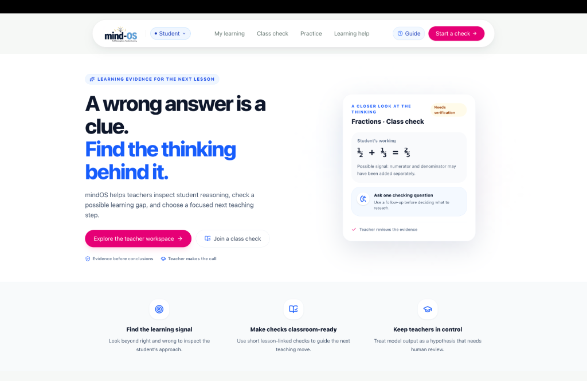

# mindOS — Cognitive Learning Diagnostics Platform

<div align="center">
  

  <p align="center">
    <strong>A wrong answer is a clue. Find the thinking behind it.</strong><br />
    Evidence-based AI learning diagnostic engine detecting root-cause misconceptions across Mathematics, Science, and Social Science.
  </p>

  <p align="center">
    <a href="#key-features">Key Features</a> •
    <a href="#quickstart">Quickstart</a> •
    <a href="#architecture">Architecture</a> •
    <a href="#diagnostic-taxonomy">Diagnostic Taxonomy</a> •
    <a href="#teacher--student-workflows">Workflows</a> •
    <a href="#license">License</a>
  </p>
</div>

---

## 🌟 Overview

**mindOS** is an intelligent classroom learning diagnostic platform designed to uncover *why* students make errors instead of merely scoring responses as binary right or wrong. 

By combining cognitive learning science, distractor-mapped item banks, and Bayesian evidence updating, mindOS identifies root-cause conceptual gaps, procedural slips, intuitive misconceptions, and recall errors — empowering educators with actionable 5-minute reteach strategies.

---

## 🚀 Key Features

- **Floating Adaptive Pill Navigation**: Modern, distraction-free pill navbar with responsive states and instant student/teacher role switching.
- **Multidisciplinary Curriculum Diagnostics**: Practice banks and exit tickets across **Mathematics**, **Science** (Electricity, Optics, Chemical Reactions), and **Social Science** (History, Political Science, Economics).
- **50 COGNIVAULT Pattern Hypotheses**: Standardized classification mapped against NCERT & CBSE learning outcomes (C1 Conceptual, C2 Logical Reasoning, C3 Procedural, C4 Misconception, C5 Recall).
- **Safe Multi-Test Policy**: Never labels a student from a single response. Every preliminary hypothesis triggers a targeted verification follow-up probe and requires teacher review.
- **Interactive Teacher Workspace**: Live exit-ticket dashboards, automated error clustering, student review queue, and counter-example generator.
- **Mathematical Expression Engine**: Seamless inline LaTeX and mathematical fraction formatting for algebraic expressions.
- **Integrated User Manual (`?` Guide)**: Built-in onboarding manual accessible from anywhere in the platform.

---

## 🧠 Diagnostic Taxonomy

mindOS categorizes student errors into 5 foundational cognitive error dimensions:

| Category Code | Dimension | Observable Indicator | Example Remediation |
| :--- | :--- | :--- | :--- |
| **C1** | **Conceptual Gap** | Misapplies definitions or fundamental principles | Concrete visual representations & analogical scaffolds |
| **C2** | **Logical Reasoning** | Correct steps but invalid deductive link | Counter-example generation & claim-evidence reconciliation |
| **C3** | **Procedural Slip** | Knows formula but makes sign/step order execution error | Worked-example contrast & sequence checklist |
| **C4** | **Intuitive Misconception** | Strong naive mental model (e.g. adding denominators directly) | Cognitive conflict probe & targeted boundary testing |
| **C5** | **Factual Recall** | Forgets core constant, notation, or terminology | Spaced retrieval cues & teach-back prompts |

---

## 🛠️ Tech Stack

- **Frontend**: React 19, TypeScript, Tailwind CSS, Lucide Icons, Vite
- **Backend**: Node.js, Express REST API, TypeScript (`tsx`)
- **Diagnostic Engine**: Bayesian belief updater, Distractor pattern matching, COGNIVAULT registry
- **Data Persistence**: In-memory session store with exportable student progress transcripts

---

## 💻 Quickstart

### Prerequisites

- **Node.js** (v18+ recommended)
- **npm** (v9+)

### Installation & Local Setup

1. **Clone the repository**:
   ```bash
   git clone https://github.com/pj2411/mindOS.git
   cd mindOS
   ```

2. **Install dependencies**:
   ```bash
   npm install --legacy-peer-deps
   ```

3. **Start the local development server**:
   ```bash
   npm run dev
   ```

4. **Open in browser**:
   Navigate to [`http://localhost:3000`](http://localhost:3000)

---

## 🧭 Teacher & Student Workflows

### 👩‍🏫 Teacher Workflow
1. Navigate to **Class check** and select or create an Exit Ticket (e.g., *FRAC-7A*).
2. Share the check code with the classroom.
3. Inspect live student submissions clustered by diagnosed misconception.
4. Review provisional AI signals, approve/adjust diagnoses, and assign counter-example reteach tasks.

### 🧑‍🎓 Student Workflow
1. Open **My learning** to view curriculum mastery across Mathematics, Science, and Social Science.
2. Complete interactive diagnostic items and explain intermediate working steps.
3. Answer the single targeted follow-up probe to verify understanding.
4. Receive targeted, blame-free feedback with step-by-step visual help.

---

## 🔒 Privacy & Safety

- **FERPA & DPDP Compliant**: Student responses are used strictly for formative instructional feedback.
- **No Autonomous High-Stakes Decisions**: AI signals remain hypotheses requiring human teacher oversight.
- **Transparent Auditing**: Full Bayesian posterior steps and evidence trails are visible in each report.

---

## 📄 License

Distributed under the Apache 2.0 License. See `LICENSE` for more information.

---

<div align="center">
  <sub>Built with ❤️ for thoughtful, evidence-based classroom teaching.</sub>
</div>